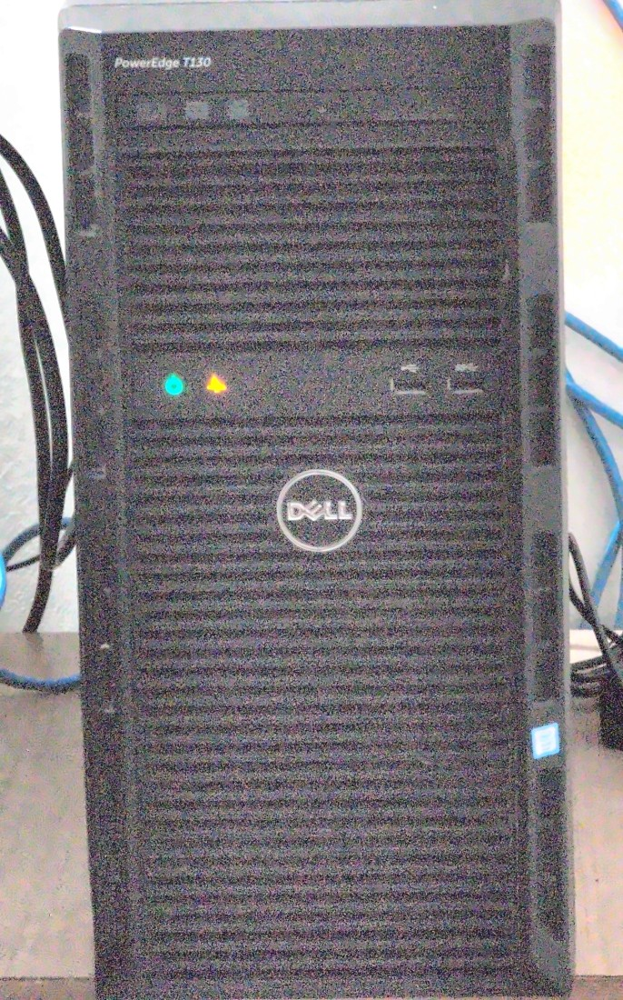

# anvil

[](https://github.com/memetics19/anvil/actions/workflows/ci.yml?query=branch%3Amain)

Terraform and Ansible for a single-node Proxmox homelab.

A smith shapes everything else on the anvil. Every host in the lab is built from this
repo, and a broken one gets rebuilt from it instead of fixed by hand.

Terraform ([bpg/proxmox](https://github.com/bpg/terraform-provider-proxmox)) defines the
VMs, Ansible configures the Proxmox host and the guests, and HashiCorp Vault holds the
secrets and site values. Terraform state lives in an S3 bucket on a single-node Ceph
cluster on the same host.

It is a work in progress. See the [Roadmap](#roadmap).

## Hardware



- Dell PowerEdge T130 tower server:
  - CPU: `Intel Xeon E3-1220 v6 @ 3.00GHz` (4 cores, 4 threads)
  - RAM: `32GB` DDR4-2400 ECC (4 × 8GB)
  - RAID controller: `PERC H730` (each disk is its own virtual disk)
  - Disks: `4TB` Seagate Exos 7200 rpm (Proxmox, VM disks, media) and `1TB` Seagate Exos 7200 rpm (Ceph OSD)
  - Network: 2 × `1GbE` (Broadcom BCM5720)
  - Out-of-band: iDRAC8
- Cisco managed switch

## Hosts

| Host       | Runs |
|------------|------|
| `pve`      | Proxmox VE 8.4, LAN gateway and NAT, NetBird, Ceph |
| `frigate`  | Frigate, Mosquitto, Gotify, nginx, cloudflared |
| `netbird`  | NetBird routing peer, Redis, ntfy, Pulse, cloudflared |
| `ragnarok` | ARR stack, IPTV, Filestash, cloudflared |
| `vault`    | HashiCorp Vault |
| `apps`     | Pi-hole and Unbound, the Caddy service gateway, Homepage, Vaultwarden |

[docs/services.md](docs/services.md) describes what runs on each one.

## Quick start

You need a Mac, because the scripts keep secrets in its Keychain, and a Proxmox VE host.
Install the tools listed in [docs/setup.md](docs/setup.md#operator-machine), then check
the repo. These two targets need no secrets:

```sh
make lint secrets-scan
```

To build the lab, follow [First build](docs/setup.md#first-build). Once it runs, most work
is a dry run followed by the real run:

```sh
make vm HOST=apps ARGS="--check --diff"
make vm HOST=apps
make tf-plan
make tf-apply
make backup
```

A host that matches the code reports `changed=0`.

## Configuration

Addresses, MACs, VM IDs and the domain live in one `site` dict. Its canonical copy is in
Vault at `kv/homelab/site`. Before Vault exists, the scripts read a bootstrap copy from the
Keychain item `site-bootstrap`. [`site/site.example.yml`](site/site.example.yml) shows the
structure. Secrets are in Vault under `kv/homelab/<host>/<app>`, listed in
[docs/secrets.md](docs/secrets.md).

## Documentation

- [docs/setup.md](docs/setup.md): the operator Mac, Keychain items, the site dict, the
  first build, rebuilding on a new box, and the hand steps
- [docs/usage.md](docs/usage.md): make targets, adding a service, secrets, backups, safety
  rails, upgrades, tests, troubleshooting
- [docs/services.md](docs/services.md): what each host and role does
- [docs/secrets.md](docs/secrets.md): every Vault path and key

## Layout

```
ansible/
  inventory/      hosts by name; group_vars/all/site.yml resolves `site`
  playbooks/
  roles/
scripts/          env.sh, plan-guard.sh, backup and Keychain helpers
site/             site.example.yml
terraform/        VMs, SDN, import blocks
tests/
vault/policies/
```

## Roadmap

- [x] Secret scanning, linters, CI
- [x] Inventory, SSH bootstrap, Proxmox host base role
- [x] Host network with automatic rollback
- [x] Single-node Ceph and S3 gateway for Terraform state
- [x] Terraform: adopt the existing VMs and SDN, guard against destroys
- [x] Vault VM, Keychain-held unseal keys, snapshot backups
- [x] Secrets and site values in Vault
- [x] Guest roles: base, Docker, node_exporter, cloudflared
- [x] Workload roles for `frigate`, `ragnarok` and `netbird`
- [x] Private service gateway (Caddy, wildcard DNS-01, Pi-hole records)
- [x] Pi-hole and Unbound for the home network
- [x] Homepage dashboard
- [x] Vaultwarden with encrypted backups and a restore drill
- [ ] Secrets enclave: Vault and Vaultwarden on an isolated network (in progress)
- [ ] VLANs 10/20/30 with an inter-VLAN firewall
- [ ] Monitoring: VictoriaMetrics, Grafana, exporters, alerts to ntfy
- [ ] Single sign-on (Authelia) in front of the gateway
- [ ] Self-hosted NetBird next to the hosted one
- [ ] Bare-metal provisioning of the second server (iDRAC virtual media or Tinkerbell)
- [ ] Releases: semver tags and a changelog from conventional commits (release-please),
  published as GitHub Releases
- [ ] Split the generic core (roles, Terraform modules, scripts) from this lab's site
  layer, so it works on another Proxmox box
- [ ] An `anvil` CLI (init, check, apply, backup, restore) over the make targets
- [ ] Packages: a `.deb` built with nfpm on each release (the CLI and the repo under
  /usr/share/anvil, depending on ansible, terraform, vault, jq and age) in an apt repo on
  GitHub Pages, plus a Homebrew tap for macOS, all attached to the GitHub Release
- [ ] The rebuild runbook, tested on a second server

## Known issues

- Frigate's camera has not answered since 2026-01-13, so there are no new recordings.
- Frigate's `genai` provider points at an Ollama address that does not answer.
- `/home` on `ragnarok` is 98% full.
- The Ceph dashboard's Object Gateway zone and multisite pages return 500 on Proxmox. See
  [Ceph](docs/services.md#ceph).

## License

[MIT](LICENSE)
